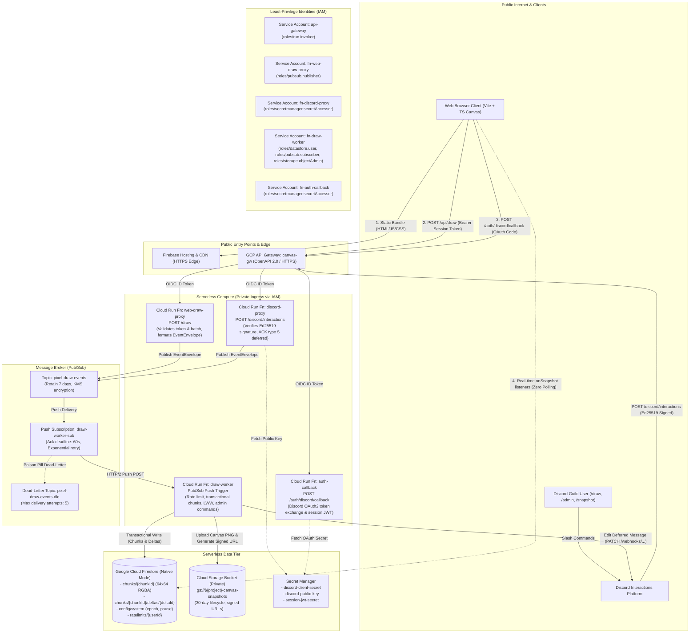

# GCP Architecture Diagram (Issue #91)

This document provides the authoritative, real-world Google Cloud architecture diagram for the collaborative pixel canvas (r/place clone), fulfilling GitHub Issue **#91** and Milestone 7 requirements.

Every component, protocol, IAM boundary, and data flow documented here corresponds 1:1 with Terraform resources in `infra/serverless/` and `infra/foundation/`.

---

## 1. System Architecture Overview

---

## 2. Request Flows & Protocol Details

### Flow A: Interactive Web Drawing & Real-Time Sync (Zero Polling)
1. **User Action**: The web user draws pixels on the HTML5 Canvas using the brush or single-pixel tool.
2. **Proxy Dispatch**: The frontend optimistically renders the strokes and sends `POST /api/draw` with a short-lived session token to the **API Gateway**.
3. **Authentication & Validation**: The API Gateway forwards the request to `web-draw-proxy` using Google OIDC service account authentication. `web-draw-proxy` validates the coordinate bounds (`0..9999`), color format (`#RRGGBB`), and token validity.
4. **Asynchronous Decoupling**: `web-draw-proxy` packages the pixels into a standard `EventEnvelope<PixelDrawData>` and publishes it to `pixel-draw-events`. It immediately returns `202 Accepted` with a tracking `correlationId`. **Zero direct database writes occur from the client or proxy.**
5. **Worker Processing**: Pub/Sub pushes the message to `draw-worker` via `draw-worker-sub`. The worker verifies rate limits (token bucket: 20 tokens max, 1 token / 3s refill) and current pause status.
6. **Transactional Storage**: The worker maps pixels to their respective 64×64 chunk documents (`chunks/{chunkId}`) and performs atomic transactional updates with Last-Write-Wins (LWW) timestamps and epoch precedence.
7. **Real-Time Notification**: The worker writes short-lived delta documents (`chunks/{chunkId}/deltas/{deltaId}` with 300s TTL). Connected browsers subscribed via native Firestore `onSnapshot` chunk listeners receive the updated pixels in real time and repaint their viewports automatically.

### Flow B: Discord Bot Command Execution
1. **Slash Command**: A Discord user issues `/draw`, `/get`, `/snapshot`, or `/admin pause|resume|clear|ratelimit`.
2. **Signature Verification**: Discord's interaction gateway sends `POST /discord/interactions` to the API Gateway. The `discord-proxy` function verifies the Ed25519 signature (`X-Signature-Ed25519` and `X-Signature-Timestamp`) using the public key from Secret Manager.
3. **Immediate Acknowledgement**: The proxy returns an immediate deferred acknowledgment (`type: 5`), satisfying Discord's strict 3-second timeout requirement.
4. **Message Broker**: The proxy publishes the command event with a `correlationId` to `pixel-draw-events`.
5. **Worker Execution**: `draw-worker` verifies administrative permissions (via Discord role ID or Firestore allow-list), performs the command:
   - `/draw`: Updates pixels in Firestore chunks.
   - `/get`: Renders the current canvas into a 64×64 PNG tile stream and responds.
   - `/snapshot`: Renders the canvas, uploads a timestamped PNG to private bucket `gs://${project}-canvas-snapshots`, generates a 1-hour signed URL, and patches the interaction response via Discord REST API v10 (`PATCH /webhooks/{applicationId}/{interactionToken}/messages/@original`).
   - `/admin clear`: Increments `epoch` in `config/system`, invalidating all previous pixels across the 10,000 × 10,000 canvas in $O(1)$ time complexity.

---

## 3. Terraform Resource Traceability Matrix

Every architectural component in the diagram is managed declaratively by Infrastructure as Code:

| Logical Component | Terraform Resource | Source File |
|---|---|---|
| **API Gateway** | `google_api_gateway_gateway.main` `google_api_gateway_api_config.main` | `infra/serverless/gateway.tf` |
| **API Gateway IAM** | `google_service_account.api_gateway` `roles/run.invoker` bindings | `infra/serverless/iam.tf` `infra/serverless/function_*.tf` |
| **Web Draw Proxy** | `google_cloudfunctions2_function.web_draw_proxy` `google_service_account.fn_web_draw_proxy` | `infra/serverless/function_web_draw_proxy.tf` `infra/serverless/iam.tf` |
| **Discord Proxy** | `google_cloudfunctions2_function.discord_proxy` `google_service_account.fn_discord_proxy` | `infra/serverless/function_discord_proxy.tf` (PR #157) `infra/serverless/iam.tf` |
| **Auth Callback** | `google_cloudfunctions2_function.auth_callback` `google_service_account.fn_auth_callback` | `infra/serverless/function_auth_callback.tf` `infra/serverless/iam.tf` |
| **Draw Worker** | `google_cloudfunctions2_function.draw_worker` `google_service_account.fn_draw_worker` | `infra/serverless/function_draw_worker.tf` `infra/serverless/iam.tf` |
| **Pub/Sub Topic** | `google_pubsub_topic.pixel_draw_events` | `infra/serverless/pubsub.tf` |
| **Pub/Sub Push Sub** | `google_pubsub_subscription.draw_worker_sub` | `infra/serverless/pubsub.tf` |
| **Pub/Sub DLQ** | `google_pubsub_topic.pixel_draw_events_dlq` | `infra/serverless/pubsub.tf` |
| **Firestore Database** | `google_firestore_database.database` (Native Mode) | `infra/serverless/firestore.tf` |
| **Firestore Rules** | `google_firebaserules_ruleset.firestore` `google_firebaserules_release.firestore` | `infra/serverless/firestore_rules.tf` `infra/serverless/firestore.rules` |
| **Snapshots Bucket** | `google_storage_bucket.canvas_snapshots` (Private, 30d TTL) | `infra/serverless/bucket_snapshots.tf` |
| **Secret Manager** | `google_secret_manager_secret.discord_client_secret` `google_secret_manager_secret.session_jwt_secret` | `infra/serverless/secrets.tf` |
| **Application Dashboard** | `google_monitoring_dashboard.serverless_app` | `infra/serverless/dashboards.tf` |
| **Alert Policies** | `google_monitoring_alert_policy.cloud_functions_error_rate` `google_monitoring_alert_policy.pubsub_dlq_backlog` | `infra/serverless/alerts.tf` |
