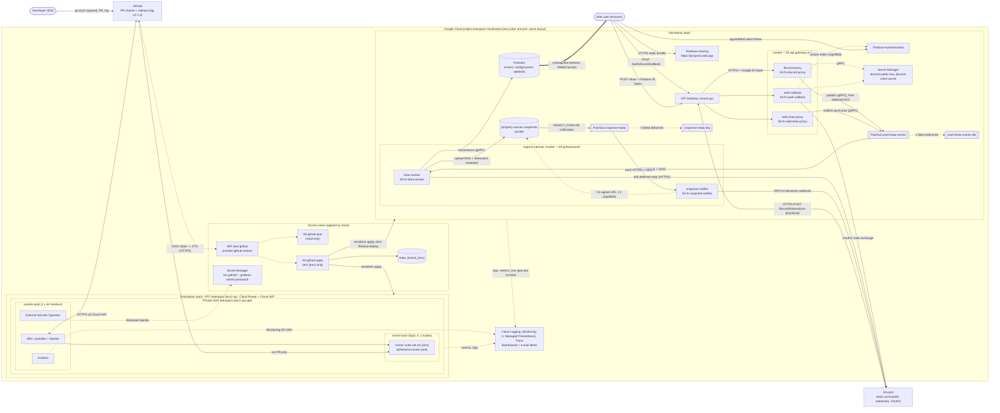

# Architecture (Issue #91)

What runs where on Google Cloud, how the pieces talk to each other, and who may call what. Read it
before the defense, or before you change a flow. Every name below is taken from the Terraform code
(`infra/access`, `infra/foundation`, `infra/serverless`), the workflows (`.github/workflows`) or the
function sources (`app/functions/*`).

dev and prd use the same layout, each in its own project (`teampasx-cloudnative-dev`,
`teampasx-cloudnative-prd`, region `europe-west1`). Only the values in `<stack>/<env>.tfvars`
differ, such as the network ranges (ADR-0004, ADR-0013).

This page describes `main` plus the three pull requests merged for the final delivery:

- #176: discord-proxy defers and publishes; one span per function in Cloud Trace;
- #177: frontend on Firebase Hosting, deployed by the release;
- #178: snapshot-notifier, plus the Artifact Registry repository `functions`.

## The diagram

- **Source:** [architecture.drawio](architecture.drawio). It uses the draw.io GCP shapes
  (`mxgraph.gcp2.*`). Open it in [diagrams.net](https://app.diagrams.net) (*File > Open from >
  Device*) or with the draw.io VS Code extension.
- **Export a PNG:** in diagrams.net, *File > Export as > PNG...*, zoom 100 %, border 10, check
  *Include a copy of my diagram* so the PNG can be edited again. Save it next to the source as
  `docs/architecture.png`.
- **Keep it true:** when a pull request adds, renames or removes a component, a flow or a
  service-account grant, it updates the `.drawio` and the Mermaid chart below in the same pull
  request.

## Overview (Mermaid)

## Flows

### 1. Delivery: IDE to production

A developer commits (signed) on a feature branch and opens a pull request. The ruleset
`protect-main` on `main` requires a pull request with one approving review, signed commits and the
gitleaks check. It also forbids force pushes and deletion.

On the pull request:

- `terraform-ci` runs `fmt`, `validate`, `tflint` and a `plan` of the three stacks in dev and prd,
  as **github-plan**;
- `functions-ci` builds and tests the six functions;
- `frontend-ci` and `secret-scan` test the frontend and scan for secrets.

After review and merge, a signed tag `vX.Y.Z` on `main` starts `terraform-deploy`. Its jobs run in
this order: `check-tag`, `foundation-dev`, `serverless-dev`, `frontend-dev`, then `foundation-prd`,
`serverless-prd`, `frontend-prd`.

Each job runs in the GitHub environment of the same name, which is the only way to impersonate
**github-apply**. The `prd` environment has required reviewers (the three members), so prd starts
only after an approval. `frontend-deploy.yml` (job *deploy frontend to {env}*) builds `app/frontend`
from the Terraform output `frontend_build_env`. It then runs `firebase deploy --only hosting` with
firebase-tools 15.36.0, using the same keyless credentials. The access stack is applied by hand by
an Owner, because the pipeline runs with its identities ([ci.md](ci.md), ADR-0011, ADR-0012).

No key is stored in GitHub. The job presents its GitHub OIDC token to the workload identity pool
`github` (provider `github-actions`, accepted only for `R-PalaceOnDanse/Cloud-Native-DevOps`), and
Google returns short-lived credentials.

### 2. Self-hosted runners

The ARC controller (`arc-systems`) watches GitHub through a listener. When a job asks for
`arc-dev` or `arc-prd`, it creates an ephemeral runner pod in `arc-runners`, at most 2
(`maxRunners`), none when idle (`minRunners 0`). The pod tolerates the `runner=true:NoSchedule`
taint, so it can only land on `runner-pool`. The cluster autoscaler adds a Spot `e2-medium` node
for it (0 to 2 nodes) and removes the node once it is empty. The nodes are private. They reach
GitHub and the image registry through Cloud NAT. The GitHub App credentials of the controller sit in
Secret Manager, and External Secrets Operator copies them into the cluster with Workload Identity.
The PR checks use these runners when the repository variable `RUNNER_LABEL` is set. Deploy and
destroy always stay on `ubuntu-latest` ([infra.md](infra.md), ADR-0014, ADR-0016).

### 3. Discord command

1. Discord sends the interaction to `POST /discord/interactions` on the gateway, signed with
   Ed25519.
2. The gateway calls `discord-proxy` with a Google ID token of the service account `api-gateway`.
3. `discord-proxy` reads the application's public key from Secret Manager (`discord-public-key`,
   cached), and checks `X-Signature-Ed25519` over timestamp + raw body. A request that fails the
   check gets 401. A PING gets a PONG.
4. For a slash command, it builds the event (`interaction.ts`):
   - `/draw` becomes `pixel.draw`. Coordinates must be 0..9999, and the color a hex value or a
     palette name;
   - every other command becomes `discord.command`;
   - both carry the application ID, the interaction token and a new W3C `traceparent`.

   It publishes the event to `pixel-draw-events`, then answers a deferred response (type 5) within
   Discord's 3 seconds. Invalid input or a failed publish gets an ephemeral error message instead.
5. `draw-worker` processes the event (flow 5). It then edits the deferred reply
   (`PATCH /webhooks/{application_id}/{token}/messages/@original`), or for `/get` posts the PNG as a
   follow-up.

Commands: `/draw x y color`, `/get`, `/snapshot`, `/admin pause|resume|clear|ratelimit`
(`scripts/register-discord-commands.mjs`). The proxy has no business logic. The worker decides
authorization, pause and rate limit. Who counts as an admin: the Discord role `ADMIN_ROLE_ID`, the
users `ADMIN_USER_IDS`, or `config/system.admins` (ADR-0019).

### 4. Web sign-in and drawing

1. The browser loads the static bundle from the Firebase Hosting default site
   (`https://{project}.web.app`, `google_firebase_hosting_site.default`, config
   `app/frontend/firebase.json`).
2. *Connexion Discord* redirects to Discord OAuth2 (scope `identify`) with an anti-CSRF `state`.
   Discord sends the browser back to the frontend origin with a `code`.
3. The browser posts `code` and `state` to `POST /auth/discord/callback`. `auth-callback` reads
   `discord-client-secret` from Secret Manager and exchanges the code with Discord. It drops the
   Discord access token and returns a Firebase **custom token** for the UID `discord:{id}`. It
   signs that token through IAM signBlob with its own identity, so no key file exists.
4. The browser calls `signInWithCustomToken` and gets a Firebase **ID token**, which the SDK
   refreshes.
5. A click or a brush stroke sends `POST /draw` with `Authorization: Bearer <ID token>`. The gateway
   checks the token (issuer `securetoken.google.com/{project}`, audience `{project}`, signature,
   expiry). It forwards the claims in `X-Apigateway-Api-Userinfo`.
6. `web-draw-proxy` accepts only `discord:<digits>` users. It validates the batch (at most 100
   pixels, coordinates 0..9999, `#RRGGBB`) and publishes a `pixel.draw` event with a W3C
   `traceparent`. It answers 202 and never writes to the database.

### 5. Worker and data

Pub/Sub pushes each message of `pixel-draw-events` to `draw-worker` through the subscription
`draw-worker-sub`, over HTTPS with an OIDC token of `pubsub-push` (ack deadline 60 s, backoff 10 to
600 s). For a draw, the worker reads `config/system`: if drawing is paused, it rejects the draw. It
then consumes the user's token bucket in `ratelimits/{userId}` (20 pixels per minute by default,
`/admin ratelimit` overrides it), and writes each 64 x 64 chunk `chunks/chunk_X_Y` in one Firestore
transaction. The transaction checks the current epoch, applies last-write-wins per pixel, and skips
an event it has already processed. `/admin clear` increments the epoch, then deletes the chunks.

The worker answers 200 when it rejects a draw on purpose (paused, rate limited, invalid,
unauthorized), so Pub/Sub does not retry it. Pub/Sub push retries any non-2xx answer: a 500 on a
transient error, and also the 400 on a message that cannot be parsed. After 5 failed deliveries the
message goes to `pixel-draw-events-dlq`, kept 7 days by the subscription
`pixel-draw-events-dlq-inspection`. `draw-worker` scales from 0 to `worker_max_instances` (10), and
Pub/Sub buffers the rest.

### 6. Real time

The frontend opens one Firestore `onSnapshot` listener per visible chunk, plus one on
`config/system`, and drops the listeners of chunks that leave the viewport. The Web SDK keeps them
on a WebChannel stream over HTTPS, so the client never polls. A pixel written by the worker reaches
every open browser, whether it was drawn from the web or from Discord. The Firestore rules allow a
signed-in user to read `chunks` and `config`, and forbid every client write (ADR-0007, ADR-0008).

### 7. Snapshot

`/snapshot` is event-driven: nothing calls the notifier, the bucket event does (C07 §2, #169).

1. `draw-worker` checks the caller is an admin. It edits the Discord answer to "being prepared",
   then renders the painted area.
2. It uploads `snapshots/{timestamp}.png` to the private bucket `{project}-canvas-snapshots`. The
   object carries custom metadata: `applicationId`, `interactionToken`, `correlationId`,
   `traceparent`, `requestedBy`. The worker holds only `roles/storage.objectCreator` on the bucket,
   so it cannot read or sign the image.
3. The bucket notification (`OBJECT_FINALIZE`, prefix `snapshots/`, payload `JSON_API_V1`, published
   by the Cloud Storage service agent) sends the object to the topic `snapshot-ready`.
4. The subscription `snapshot-notifier-sub` pushes it to `snapshot-notifier` (HTTPS + OIDC of
   `pubsub-push`, backoff 5 to 60 s, 5 attempts, then `snapshot-ready-dlq`).
5. `snapshot-notifier` signs a **V4 URL valid one hour** with its own identity (IAM signBlob, no key
   file). It then edits the original answer through the interaction webhook. The interaction token
   is valid 15 minutes. It answers 200 when there is nothing to do or Discord refuses for good, and
   500 on a transient failure, so Pub/Sub retries.

The bucket has public access prevention enforced, uniform access, and a 30-day lifecycle.

### 8. Observability

Every function writes JSON lines to stdout: severity, `correlationId`, and
`logging.googleapis.com/trace`. `discord-proxy`, `web-draw-proxy`, `draw-worker` and
`snapshot-notifier` also export **one span each** to Cloud Trace with the API v2 (`src/trace.ts`,
`batchWrite`, role `cloudtrace.agent`). The trace ID travels in the `traceparent` of the event, and
for snapshots in the object metadata. So a request is one trace: proxy span -> `draw-worker` span
(child of the proxy span) -> `snapshot-notifier` span (child of the worker span), with the logs of
each next to it.

GKE sends its system metrics and logs to Cloud Monitoring and Logging. Managed Prometheus scrapes
the ARC metrics (`gha_*`, PodMonitoring `arc-metrics`).

Dashboards (as code):

- *Canvas Serverless Application Dashboard*: invocations, 5xx, p95 latency, Pub/Sub backlog and
  age, DLQ;
- *{vpc}-gke-overview*: nodes per pool, CPU, memory, restarts;
- Grafana `cluster.json` and `serverless.json`, through `kubectl port-forward`.

Every alert e-mails the three team members. Application alerts: functions 5xx rate, messages sent
to `pixel-draw-events-dlq` or `snapshot-ready-dlq`, oldest unacked message on `draw-worker-sub` over
60 s. Cluster alerts: node CPU or memory over 85 %, container restarts, runner jobs waiting 10 min,
`hello` 5xx (ADR-0010, ADR-0021, [observability.md](observability.md)).

## IAM boundaries

| Identity | Used by | Grants (from the Terraform code) |
|---|---|---|
| `github-plan` | PR workflows | viewer, iam.securityReviewer, serviceUsageConsumer, apiKeysViewer, custom `helmStateReader`; objectAdmin on the state bucket |
| `github-apply` | jobs of the GitHub environment `{env}` only (terraform-run, frontend-deploy) | scoped admin roles listed in `infra/access/main.tf` (no Editor), including firebase.admin and artifactregistry.admin; objectAdmin on the state bucket |
| `api-gateway` | API Gateway (minted by the API Gateway service agent) | `run.invoker` on `hello`, `discord-proxy`, `web-draw-proxy`, `auth-callback` only |
| `fn-discord-proxy` | discord-proxy | logWriter, cloudtrace.agent; accessor on `discord-public-key`; publisher on `pixel-draw-events` (topic-level) |
| `fn-web-draw-proxy` | web-draw-proxy | logWriter, cloudtrace.agent; publisher on `pixel-draw-events` (topic-level) |
| `fn-auth-callback` | auth-callback | logWriter, cloudtrace.agent; accessor on `discord-client-secret`; TokenCreator on itself |
| `fn-draw-worker` | draw-worker | logWriter, datastore.user, cloudtrace.agent; objectCreator on the snapshots bucket |
| `fn-snapshot-notifier` | snapshot-notifier | logWriter, cloudtrace.agent; objectViewer on the snapshots bucket; TokenCreator on itself |
| `pubsub-push` | push subscriptions `draw-worker-sub` and `snapshot-notifier-sub` | `run.invoker` on `draw-worker` and `snapshot-notifier` only |
| `fn-hello` | hello (C05 demo) | logWriter, cloudtrace.agent; accessor on `hello-greeting` |
| `fn-build` | Cloud Build of the functions | logWriter, artifactregistry.writer, storage.objectViewer |
| Cloud Storage service agent | bucket notification | publisher on `snapshot-ready` only |
| KSA `external-secrets` (WI) | External Secrets Operator | accessor on the four `arc-github-*` secrets and `grafana-admin-password` |
| KSA `grafana` (WI) | Grafana | monitoring.viewer |

The security walk-through ([security-walkthrough.md](security-walkthrough.md)) details each
boundary and how to prove it.

## Where each component is defined

| Component | Terraform resource or file | File |
|---|---|---|
| Workload identity, github-plan / github-apply | `google_iam_workload_identity_pool.github`, `google_service_account.plan` / `.apply` | `infra/access/main.tf` |
| Runner and Grafana secrets | `google_secret_manager_secret.arc_github_*`, `.grafana_admin_password` | `infra/access/runner_secret.tf`, `grafana_secret.tf` |
| VPC, subnet, router, NAT | `google_compute_network.main`, `google_compute_subnetwork.subnet_k8s`, `google_compute_router.router`, `google_compute_router_nat.nat` | `infra/foundation/main.tf` |
| GKE and node pools | `google_container_cluster.primary`, `google_container_node_pool.system` / `.runners` | `infra/foundation/gke.tf` |
| ARC | `helm_release.arc_controller`, `.arc_runner`, `.arc_metrics` | `infra/foundation/helm-arc.tf` |
| External Secrets Operator | `helm_release.external_secrets`, `.arc_secret` | `infra/foundation/helm-eso.tf` |
| Grafana | `helm_release.grafana`, `.grafana_secret` | `infra/foundation/helm-grafana.tf` |
| Cluster dashboard and alerts | `google_monitoring_dashboard.cluster`, `google_monitoring_alert_policy.*` | `infra/foundation/monitoring.tf` |
| API Gateway | `google_api_gateway_api.canvas`, `_api_config.canvas`, `_gateway.canvas` | `infra/serverless/gateway.tf`, `openapi.yaml.tftpl` |
| Functions | `google_cloudfunctions2_function.{discord_proxy,web_draw_proxy,auth_callback,draw_worker,snapshot_notifier,hello}` | `infra/serverless/function_*.tf` |
| Function images | `google_artifact_registry_repository.functions` | `infra/serverless/artifact_registry.tf` |
| Service accounts | `google_service_account.*` | `infra/serverless/iam.tf`, `pubsub.tf` |
| Pub/Sub | `google_pubsub_topic.pixel_draw` / `.pixel_draw_dlq` / `.snapshot_ready` / `.snapshot_ready_dlq`, `google_pubsub_subscription.draw_worker` / `.snapshot_notifier` / `.dlq_inspection` / `.snapshot_dlq_inspection` | `infra/serverless/pubsub.tf` |
| Bucket notification | `google_storage_notification.snapshot_ready` | `infra/serverless/pubsub.tf` |
| Firestore and rules | `google_firestore_database.canvas`, `google_firebaserules_ruleset.firestore` | `infra/serverless/firestore.tf`, `firestore_rules.tf`, `firestore.rules` |
| Snapshots bucket | `google_storage_bucket.snapshots` | `infra/serverless/bucket_snapshots.tf` |
| Secrets | `google_secret_manager_secret.{discord_public_key,discord_client_secret,hello_greeting}` | `infra/serverless/secrets.tf` |
| Firebase project, Auth, web app, Hosting site | `google_firebase_project.this`, `google_identity_platform_config.this`, `google_firebase_web_app.canvas`, `google_firebase_hosting_site.default` | `infra/serverless/firebase.tf` |
| Hosting content and headers | `firebase deploy --only hosting` | `.github/workflows/frontend-deploy.yml`, `app/frontend/firebase.json` |
| Spans | `exportSpan` (Cloud Trace API v2) | `app/functions/*/src/trace.ts` |
| App dashboard and alerts | `google_monitoring_dashboard.*`, `google_monitoring_alert_policy.*` | `infra/serverless/dashboards.tf`, `alerts.tf` |
