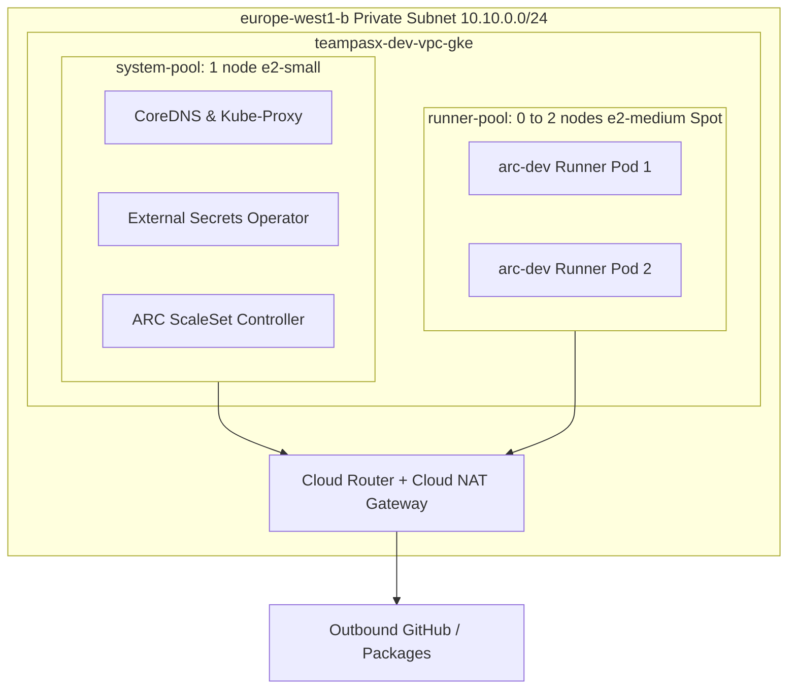

# Intermediate Review Deliverables & Audit Sheet (Milestone 0)

This deliverable dossier compiles the technical specifications, architectural proofs, and verification procedures for the **Intermediate Review** (*Jalon Intermédiaire: Foundation, DevOps & Runners*), covering requirements **C01, C02, C03, and C04**.

---

## 1. Intermediate Review Scope & Deliverables Matrix

| Subject Step | Description | Implementation Status | Evidence & Code References | Live Verification |
|---|---|:---:|---|---|
| **C01.1** | **Two Isolated GCP Projects** | ✅ Completed | - `teampasx-cloudnative-dev`<br>- `teampasx-cloudnative-prd`<br>- Documented in [docs/environments.md](file:///c:/Users/Quadu/Desktop/boulot/cloud&Serverless/docs/environments.md) | GCP Resource Manager: Two active billing-linked projects |
| **C01.2** | **Budget Alerts as Code** | ✅ Completed | - [infra/access/budget.tf](file:///c:/Users/Quadu/Desktop/boulot/cloud&Serverless/infra/access/budget.tf)<br>- 50%, 90%, 100% spend & 100% forecast thresholds<br>- Survives foundation destroy (`prevent_destroy = true`) | GCP Billing Console: Active budget with email channel |
| **C01.3** | **Instructor Read Access** | ✅ Completed | - [infra/access/members.tf](file:///c:/Users/Quadu/Desktop/boulot/cloud&Serverless/infra/access/members.tf)<br>- `roles/viewer` and `roles/browser` granted to `jeremie@jjaouen.com` | GCP IAM Console: Instructor identity bound on dev and prd |
| **C01.4** | **GPG Cryptographic Commit Signing** | ✅ Completed | - Enforced on all members (Quentin, Aurélien, Louis)<br>- GPG Key `2EE24FD45EE687600183E0DDF6572416141924C2`<br>- Conventional Commits hook [.githooks/commit-msg](file:///c:/Users/Quadu/Desktop/boulot/cloud&Serverless/.githooks/commit-msg) | GitHub commit log: Green `Verified` badge on all commits |
| **C02.1** | **Terraform Layout & Remote GCS State** | ✅ Completed | - Layout: `infra/access`, `infra/foundation`, `infra/serverless`<br>- Remote backend buckets: `teampasx-cloudnative-*-tfstate`<br>- Documented in [docs/infra.md](file:///c:/Users/Quadu/Desktop/boulot/cloud&Serverless/docs/infra.md) | Cloud Storage Console: State buckets with object locking |
| **C02.2** | **VPC Network & Non-Overlapping Subnets** | ✅ Completed | - [infra/foundation/network.tf](file:///c:/Users/Quadu/Desktop/boulot/cloud&Serverless/infra/foundation/network.tf)<br>- Dev: `10.10.0.0/24` (Pods `10.11.0.0/16`, Services `10.12.0.0/20`)<br>- Prd: `10.20.0.0/24` (Pods `10.21.0.0/16`, Services `10.22.0.0/20`)<br>- Non-overlapping spaces allow peering | VPC Network Console: Subnets and secondary ranges verified |
| **C02.3** | **Cloud Router & Cloud NAT** | ✅ Completed | - Outbound internet connectivity for private GKE nodes<br>- Zero public IPs on cluster nodes | Cloud NAT Gateway active in `europe-west1` |
| **C03.1** | **Workload Identity Federation (Keyless)** | ✅ Completed | - [infra/access/workload_identity.tf](file:///c:/Users/Quadu/Desktop/boulot/cloud&Serverless/infra/access/workload_identity.tf)<br>- Workload Identity Pool `github` + Provider `github-actions`<br>- Service accounts `github-plan` & `github-apply`<br>- Zero service account keys stored in GitHub | IAM Service Accounts: 0 user-managed keys |
| **C03.2** | **Automated CI/CD Pipelines** | ✅ Completed | - PR pipeline: [.github/workflows/ci.yml](file:///c:/Users/Quadu/Desktop/boulot/cloud&Serverless/.github/workflows/ci.yml) (fmt, validate, gitleaks, 139 tests, plan)<br>- Release pipeline: [.github/workflows/deploy.yml](file:///c:/Users/Quadu/Desktop/boulot/cloud&Serverless/.github/workflows/deploy.yml)<br>- Destroy pipeline: [.github/workflows/terraform-destroy.yml](file:///c:/Users/Quadu/Desktop/boulot/cloud&Serverless/.github/workflows/terraform-destroy.yml) | GitHub Actions: Verified passing workflow history |
| **C03.3** | **Verified Manual Destroy Workflow** | ✅ Completed | - Clean teardown tested on dev (Run `42207641972`) and prd (Run `42195805274`)<br>- Leaves `access` stack intact; rebuildable via tag release | Workflow run logs in GitHub Actions |
| **C04.1** | **Private GKE Cluster Provisioning** | ✅ Completed | - [infra/foundation/gke.tf](file:///c:/Users/Quadu/Desktop/boulot/cloud&Serverless/infra/foundation/gke.tf)<br>- Zonal cluster in `europe-west1-b`<br>- Master CIDR `/28` private peering (`172.16.0.0/28`)<br>- Private nodes enforced (`enable_private_nodes = true`) | GKE Console: Healthy cluster `teampasx-prd-vpc-gke` |
| **C04.2** | **Isolated Dedicated Node Pools** | ✅ Completed | - `system-pool`: 1 fixed `e2-small` node<br>- `runner-pool`: 0 to 2 autoscaling `e2-medium` Spot VMs<br>- Taint `runner=true:NoSchedule` isolates runners | `kubectl get nodes -L role,cloud.google.com/gke-nodepool` |
| **C04.3** | **Actions Runner Controller (ARC) Helm Deployment** | ✅ Completed | - [infra/foundation/helm-arc.tf](file:///c:/Users/Quadu/Desktop/boulot/cloud&Serverless/infra/foundation/helm-arc.tf)<br>- OCI charts `gha-runner-scale-set-controller` & `gha-runner-scale-set` (v0.9.3)<br>- Runner labels `arc-dev` and `arc-prd` | Pods in namespaces `arc-systems` and `arc-runners` |
| **C04.4** | **Organization GitHub App Authentication** | ✅ Completed | - Migrated from personal token in Issue #151 ([ADR-0016](file:///c:/Users/Quadu/Desktop/boulot/cloud&Serverless/docs/adr/0016-external-secrets-operator.md))<br>- App ID, installation ID, and PEM key stored in Secret Manager<br>- External Secrets Operator syncs secrets via Workload Identity | Kubernetes secret `arc-github` synced by ESO |
| **C04.5** | **Proven Node Autoscaling Under Load** | ✅ Completed | - Documented in [docs/runner-auto-scaling-demo.md](file:///c:/Users/Quadu/Desktop/boulot/cloud&Serverless/docs/runner-auto-scaling-demo.md)<br>- Scaling log in [docs/evidence/runner-scaling-dev.csv](file:///c:/Users/Quadu/Desktop/boulot/cloud&Serverless/docs/evidence/runner-scaling-dev.csv)<br>- Scale-up (0 $\to$ 2 nodes) under job demand; clean scale-to-zero when idle | Real-time monitoring via `scripts/watch-runner-scaling.sh` |

---

## 2. Cluster Architecture & Sizing Rationale



### Key Engineering Safeguards:
1. **Application Workload Ban on GKE**: In strict compliance with C05/C06, zero application microservices run in Kubernetes. GKE compute is exclusively allocated to developer CI runners.
2. **FinOps Spot VMs**: The runner pool uses Google Cloud Spot VMs, slashing node compute costs by 60% to 91% compared to standard on-demand VMs.
3. **Scale-to-Zero Guarantee**: The runner pool has a hard minimum of 0 nodes. When no CI workflows are queued, the pool draws 0 compute cost.
4. **Taint Isolation**: The `runner=true:NoSchedule` taint ensures system pods are never scheduled on runner nodes, which would otherwise block scale-down to 0.

---

## 3. Step-by-Step Live Verification Commands

For the intermediate review presentation, run the following verification sequence:

```bash
# 1. Connect kubectl to prd cluster
gcloud container clusters get-credentials teampasx-prd-vpc-gke \
  --zone europe-west1-b --project teampasx-cloudnative-prd

# 2. Inspect node pools and confirm runner pool scale-to-zero
kubectl get nodes -L role,cloud.google.com/gke-nodepool

# 3. Verify External Secrets Operator synchronization
kubectl get externalsecret -n arc-runners arc-github
# Expected status: SecretSynced (READY: True)

# 4. Check ARC listener health
kubectl get pods -n arc-systems
kubectl get pods -n arc-runners

# 5. Monitor dynamic node scaling under runner load
bash scripts/watch-runner-scaling.sh prd
```
