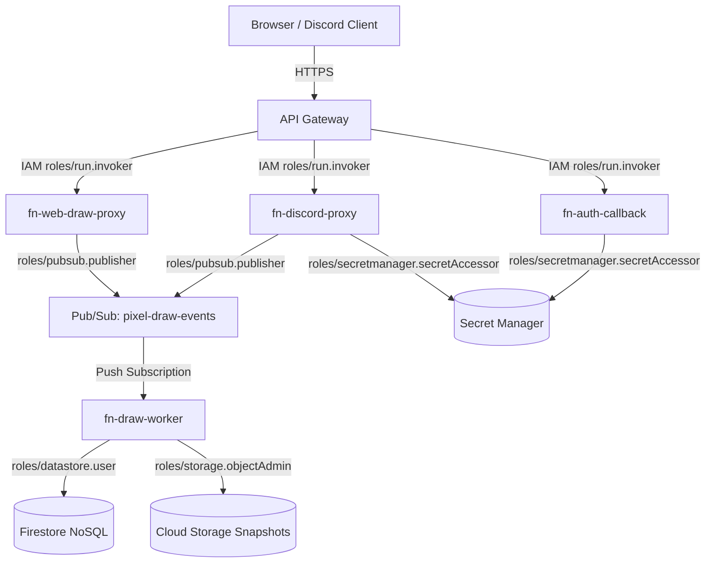

# Security Architecture Walk-Through

Comprehensive security walk-through matrix detailing least-privilege IAM, private functions and storage, secrets management, cryptographic verification, and log sanitization, mapping every claim to its exact code definition and verification command.

---

## 1. Security Architecture Principles & Claims Matrix

| Security Domain | Core Architecture Claim | Implementation Details | Code / Infrastructure Location | Verification Command / Evidence |
|---|---|---|---|---|
| **1. Keyless CI/CD Authentication** | Zero long-lived service account keys in GitHub | GitHub Actions authenticates to Google Cloud via Workload Identity Federation (WIF) using OIDC tokens issued by GitHub. | [infra/access/workload_identity.tf](file:///c:/Users/Quadu/Desktop/boulot/cloud&Serverless/infra/access/workload_identity.tf) | `gcloud iam service-accounts keys list --iam-account=github-plan@<PROJECT>.iam.gserviceaccount.com` returns 0 user-managed keys. |
| **2. Private Compute & Ingress Control** | Backend Cloud Run functions are strictly private | Cloud Run Functions (v2) reject all unauthenticated public traffic. The role `roles/run.invoker` is granted solely to the API Gateway service account. Direct HTTP invocation returns `403 Forbidden`. | [infra/serverless/iam.tf](file:///c:/Users/Quadu/Desktop/boulot/cloud&Serverless/infra/serverless/iam.tf) [infra/serverless/functions.tf](file:///c:/Users/Quadu/Desktop/boulot/cloud&Serverless/infra/serverless/functions.tf) | `curl -i https://<REGION>-<PROJECT>.cloudfunctions.net/draw-worker` returns HTTP `403 Forbidden`. |
| **3. Principle of Least Privilege (PoLP)** | Fine-grained, dedicated service account per microservice | No workload uses the default Compute Engine service account. Each component runs with its own IAM identity with minimal permissions. | [infra/serverless/iam.tf](file:///c:/Users/Quadu/Desktop/boulot/cloud&Serverless/infra/serverless/iam.tf) | Inspect IAM bindings in GCP Console: each service account has only 1 or 2 targeted roles. |
| **4. Secrets Management & Zero State Exposure** | Secrets never pass through Terraform variables or state files | Secrets (Discord bot token, public key, client secret, GitHub App private key) live in Secret Manager with `prevent_destroy = true`. Values are added out-of-band by authorized personnel. | [infra/serverless/secrets.tf](file:///c:/Users/Quadu/Desktop/boulot/cloud&Serverless/infra/serverless/secrets.tf) [infra/access/runner_secret.tf](file:///c:/Users/Quadu/Desktop/boulot/cloud&Serverless/infra/access/runner_secret.tf) | `git grep -i "secret" terraform.tfstate` finds 0 plaintext secret values. |
| **5. Private Cloud Storage & Signed URLs** | Snapshot storage is strictly private; downloads use 1h signed URLs | The Cloud Storage bucket enforces `public_access_prevention = "enforced"`. The bot generates cryptographic HMAC-signed URLs valid for exactly 3600 seconds. Lifecycle rules purge files after 30 days. | [infra/serverless/bucket_snapshots.tf](file:///c:/Users/Quadu/Desktop/boulot/cloud&Serverless/infra/serverless/bucket_snapshots.tf) [app/functions/draw-worker/src/index.ts](file:///c:/Users/Quadu/Desktop/boulot/cloud&Serverless/app/functions/draw-worker/src/index.ts) | Attempting direct bucket access `https://storage.googleapis.com/<BUCKET>/...` returns HTTP `403 AccessDenied`. |
| **6. Zero Direct Client Writes** | Browser clients cannot write to the database | Firestore security rules enforce `allow write: if false;` on all collections. All pixel modifications must flow through the API Gateway, validation proxy, and Pub/Sub queue. | [infra/serverless/firestore.rules](file:///c:/Users/Quadu/Desktop/boulot/cloud&Serverless/infra/serverless/firestore.rules) | Attempting direct write via Firebase JS SDK returns `FirebaseError: Missing or insufficient permissions`. |
| **7. Cryptographic Webhook Validation** | Discord interactions verify Ed25519 cryptographic signatures | The Discord proxy validates incoming `X-Signature-Ed25519` and `X-Signature-Timestamp` headers using `@noble/curves/ed25519` before processing. Invalid signatures immediately return HTTP 401. | [app/functions/discord-proxy/src/index.ts](file:///c:/Users/Quadu/Desktop/boulot/cloud&Serverless/app/functions/discord-proxy/src/index.ts) | Sending unsigned POST request to Discord proxy returns HTTP `401 Unauthorized`. |
| **8. Sensitive Data Redaction in Logging** | Automated redaction prevents credentials leaking to Cloud Logging | Structured logger engine automatically detects and sanitizes tokens, passwords, authorization headers, and cryptographic signatures with `[REDACTED]` before serializing JSON logs. | [app/common/src/logger.ts](file:///c:/Users/Quadu/Desktop/boulot/cloud&Serverless/app/common/src/logger.ts) [app/common/src/logger.test.ts](file:///c:/Users/Quadu/Desktop/boulot/cloud&Serverless/app/common/src/logger.test.ts) | 4 unit tests verify string, object, and nested redaction. Check Logs Explorer for `[REDACTED]`. |
| **9. Automated Secret Scanning in CI** | Commit history scanned for secrets on every PR | Gitleaks runs as an automated step on every pull request, preventing inadvertent commits of API tokens, private keys, or passwords. | [.github/workflows/ci.yml](file:///c:/Users/Quadu/Desktop/boulot/cloud&Serverless/.github/workflows/ci.yml) | GitHub Actions CI tab displays green `Secret Scan (Gitleaks)` check. |
| **10. Cryptographic Commit Signing** | All git commits are signed with developer GPG keys | Commit signatures are verified by GitHub against registered GPG keys. Git configuration enforces `commit.gpgsign = true`. | [docs/development.md](file:///c:/Users/Quadu/Desktop/boulot/cloud&Serverless/docs/development.md) | `git log --show-signature` verifies Good signature from Quentin Duval (`2EE24FD45EE687600183E0DDF6572416141924C2`). |

---

## 2. Microservice Identity & IAM Separation

The following table documents the dedicated service account assigned to each component, enforcing the Principle of Least Privilege:

### Detailed IAM Role Allocations:

1. **`sa-api-gateway` (`gateway@<PROJECT>.iam.gserviceaccount.com`)**:
   - `roles/run.invoker` on `web-draw-proxy`, `discord-proxy`, and `auth-callback`.
   - *Cannot access Firestore, Cloud Storage, or Secret Manager.*
2. **`sa-web-draw-proxy` (`web-draw-proxy@<PROJECT>.iam.gserviceaccount.com`)**:
   - `roles/pubsub.publisher` on topic `pixel-draw-events`.
   - `roles/cloudtrace.agent` to emit trace spans to Cloud Trace.
   - *Cannot write to Firestore or read Secret Manager.*
3. **`sa-discord-proxy` (`discord-proxy@<PROJECT>.iam.gserviceaccount.com`)**:
   - `roles/pubsub.publisher` on topic `pixel-draw-events`.
   - `roles/secretmanager.secretAccessor` on secret `discord-public-key`.
   - `roles/cloudtrace.agent` to emit trace spans.
   - *Cannot access Firestore or Cloud Storage.*
4. **`sa-draw-worker` (`draw-worker@<PROJECT>.iam.gserviceaccount.com`)**:
   - `roles/datastore.user` to read/write Firestore chunk documents and deltas.
   - `roles/storage.objectAdmin` on bucket `${PROJECT}-canvas-snapshots`.
   - `roles/cloudtrace.agent` to link and record span data.
   - *Cannot read OAuth client secrets or invoke other Cloud Run services.*
5. **`sa-auth-callback` (`auth-callback@<PROJECT>.iam.gserviceaccount.com`)**:
   - `roles/secretmanager.secretAccessor` on `discord-client-secret`.
   - *Cannot access Firestore or Pub/Sub.*
6. **`sa-external-secrets` (`external-secrets` K8s SA via Workload Identity)**:
   - `roles/secretmanager.secretAccessor` strictly on runner secrets (`arc-github-app-*`, `arc-github-token`).
   - *Cannot read application database, storage, or OAuth secrets.*

---

## 3. Data Protection & Network Isolation

- **In-Transit Encryption**:
  - All external ingress endpoints enforce **TLS 1.3 / HTTPS** (Google API Gateway and Cloud Storage).
  - Internal communication between API Gateway and Cloud Run uses Google's private software-defined network with mutual TLS (mTLS) managed by Google Cloud infrastructure.
- **At-Rest Encryption**:
  - Firestore database and Cloud Storage buckets are encrypted at rest using Google-managed encryption keys (FIPS 140-2 Level 1 validated).
- **Network Boundaries**:
  - GKE nodes run with `enable_private_nodes = true` and have zero public IPv4 addresses assigned.
  - Outbound traffic from GKE nodes (image pulls, GitHub API calls) routes through Google Cloud NAT with Cloud Router.
  - Subnets across `dev` (`10.10.0.0/24`) and `prd` (`10.20.0.0/24`) use non-overlapping CIDR blocks to prevent routing collisions.
